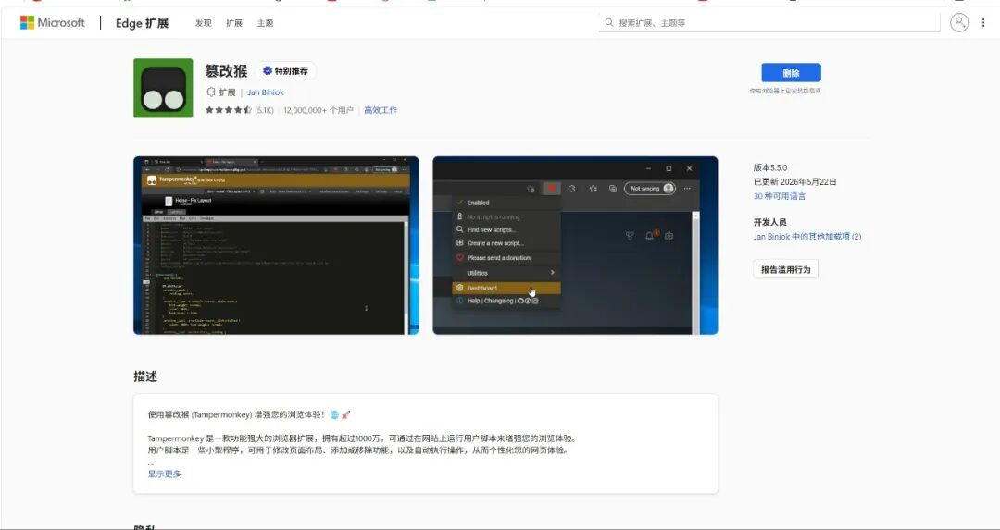
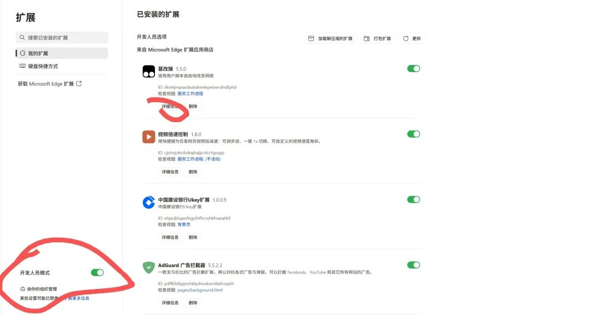
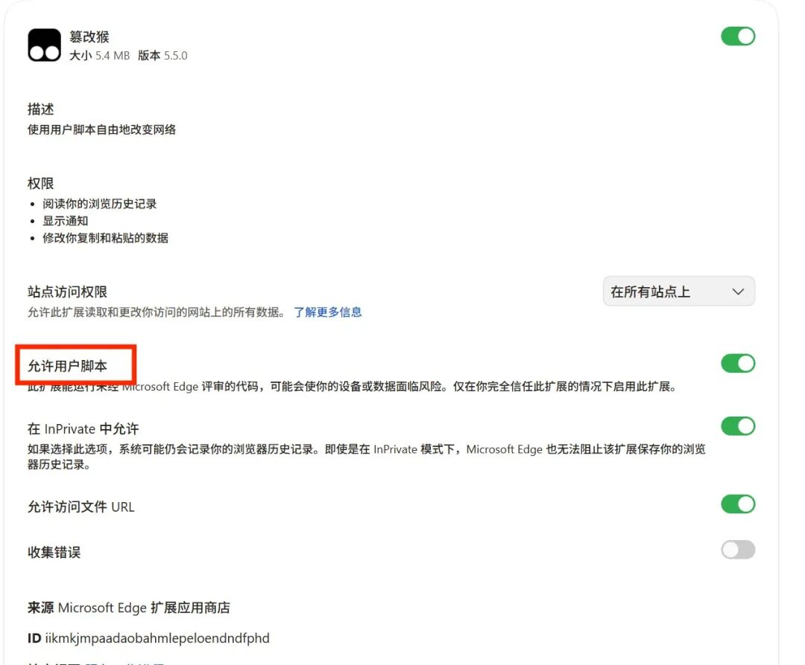
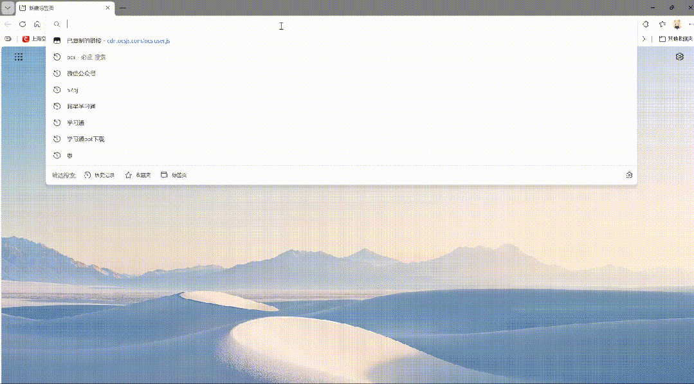

温馨提示：本教程仅供原理研究使用，请勿用于任何商业用途（包括文章中的插件）。使用的项目均使用 MIT 证书，均开源且免费。

## 前言

补档，被神秘势力下架了（为了防止再次下架可加入文章尾的 QQ 群）。

为了轻松完成学校的课程，我研究并写了本教程。

---

## 第 0 步

首先准备好电脑，mac 与 Windows 均可（mac 需要下载 Edge），打开 Edge。


## 第 1 步

打开三点，找到插件，点开获取扩展。


## 第 2 步

搜索篡改猴，点击安装。



## 第 3 步

点开插件 - 插件管理，打开开发者模式，点开详细信息，打开允许用户脚本。





## 第 4 步

安装 ocs 网课助手。

在地址栏上输入 `https://cdn.ocsjs.com/ocs.user.js`，接着会跳转到这个界面，点击安装。



## 第 5 步

登录网课网站。

这里以学某通为例。

打开网站，网址在这里：

```text
https://passport2.chaoxing.com/login?fid=&newversion=true&refer=https%3A%2F%2Fi.chaoxing.com
```

如果正常你会看到：


## 第 6 步

添加题库。

这里有三种题库（三选一）：

1. 接入 DeepSeek（需自备 API）

   详见教程：

   > https://docs.zerror.cc/local/howtouse

2. Zerror 在线题库（80% 正确率）

   详见教程：

   > https://docs.zerror.cc/online/API

3. 言溪题库

   > https://tk.enncy.cn/tk/article?uid=d5a1de0cf21b44fabedbac3d840674a4

完成（done）。

然后你就可以快乐地刷课了（可自动做题和答题）。

成果展示（bushi）：


如果这个教程对你有用，这真的对我很重要。

点个赞，关注。

如果不会，可加入下方 QQ 群询问。

QQ 交流群（技术交流、二次元、gal 闲聊均可）：


