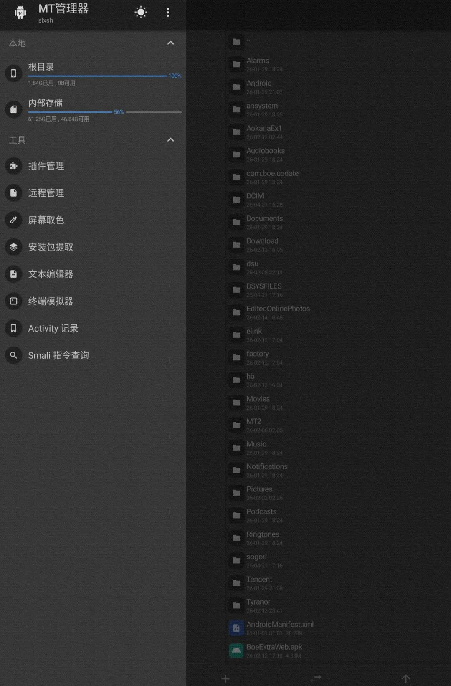
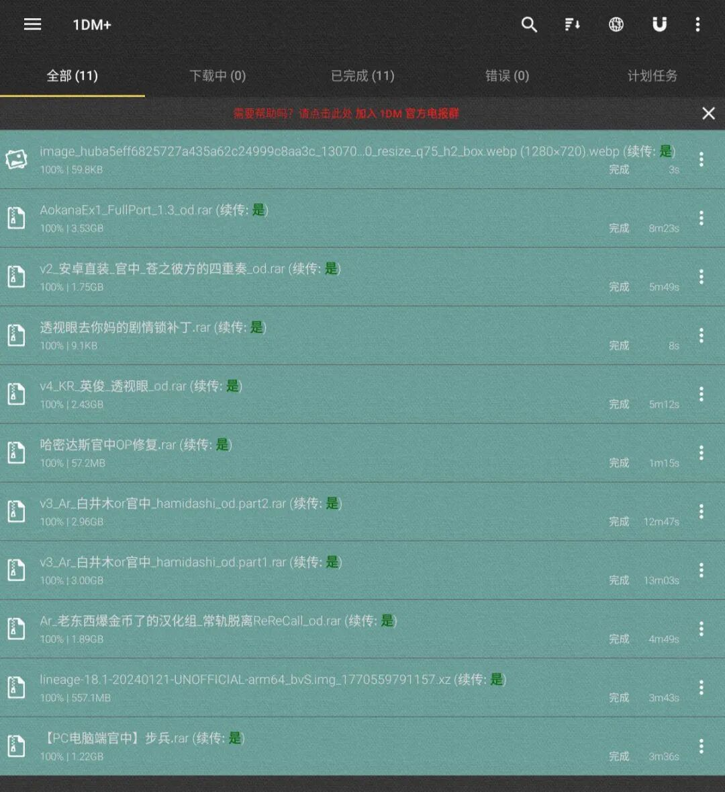
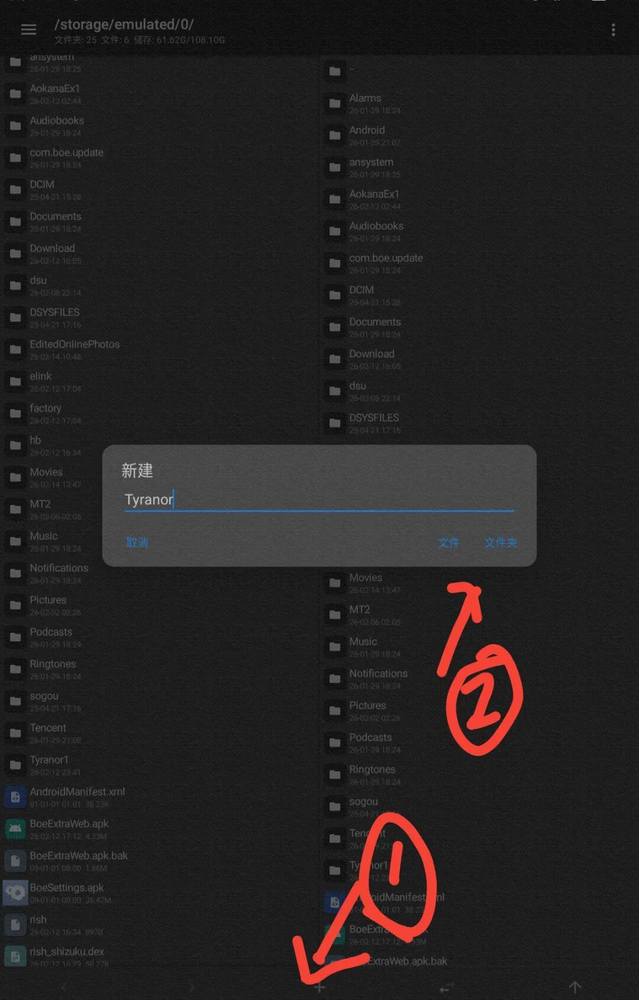
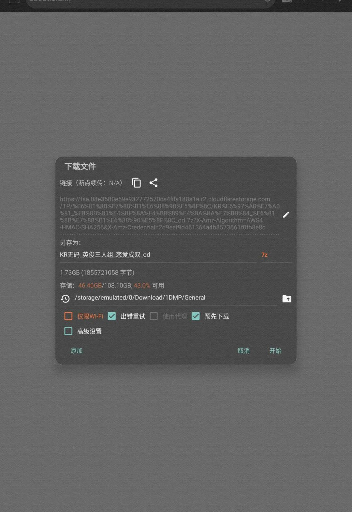
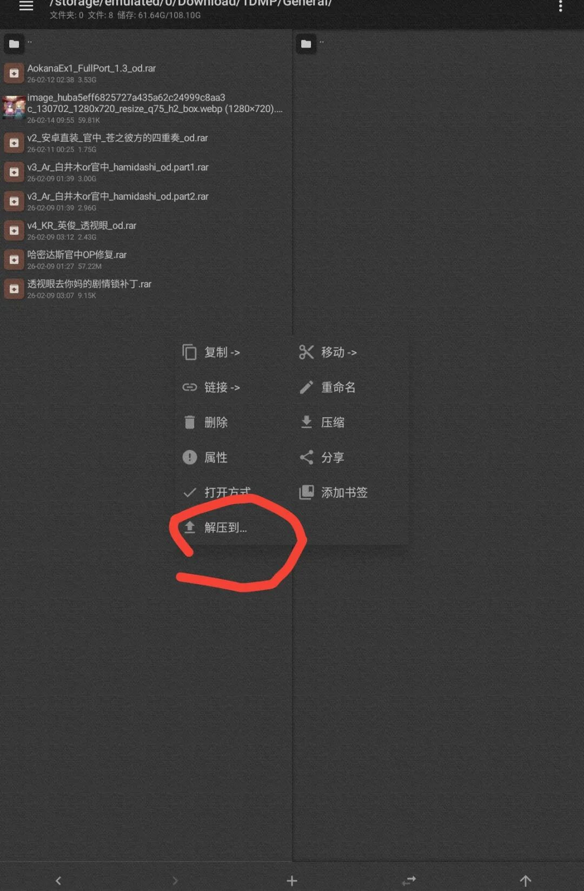
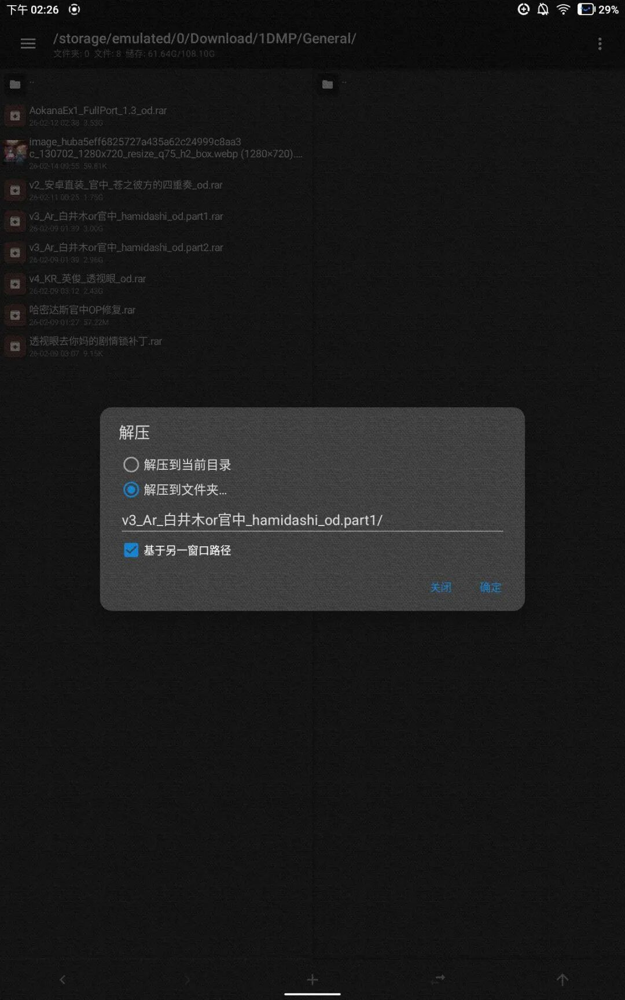
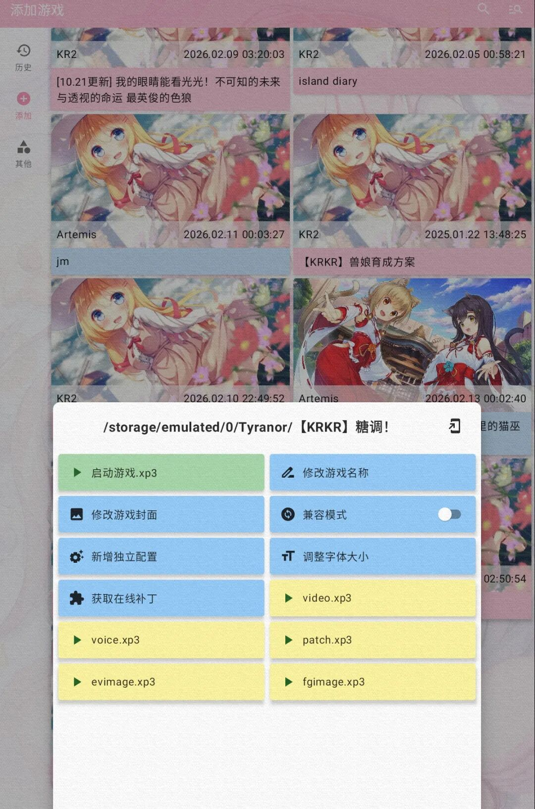

科普链接：什么是 galgame：

> https://zh.moegirl.org.cn/Galgame

## 前言

这个是我写的老教程了，更现代的模拟器应是 Tyranor Next。

这里附上 GitHub 地址：

> https://github.com/Weiss-UltimateSavior/Tyranor-Next

## -1. 了解可以在手机上运行的 galgame 类型

在开始教程之前，我们先了解一下目前主流的几种手机上 Galgame 运行方式，这样你就能根据自己的需求和游戏资源选择最合适的方案。

### -1.1 apk

这个最简单，就像安装普通 App 一样，下载 APK 文件直接安装就能玩。优点是省心，但缺点是专门为手机移植的 APK 游戏数量有限。

### -1.2 Kirikiroid2

这是目前手机玩 Galgame 最主流的方式之一。它的核心特征是游戏解压后文件有 `.xp3`。

### -1.3 Artemis Engine

其最显著的特征是解压后里面有 `.pfs`。

### -1.4 ONEScripte

其最显著的特征是解压后里面 `.nsa`。

tips：哪怕是这三个类型的 galgame 也不能直接游玩，需要大佬移植，所以找资源时后面的标签必须有「移植」才能下载。

## 0. 准备必要的工具

凡事预则立，不预则废。

### 0.1 解压工具 mt 管理器

### 0.2 下载工具 1dm

### 0.3 模拟器（此模拟器可以兼容上述所有类型）

下载：

https://pan.huang1111.cn/s/QzNbLcm

下载安装这几个软件，分别给权限。

## 1. 配置 Tyranor

### 1.1 先打开 mt，在内部储存下创建一个 Tyranor 文件夹

### 1.2 打开 Tyranor 点击检查权限，给其权限

## 2. 寻找资源，下载资源

我推荐这个网站 t-satoru.top（解压密码在常见问题中）。

找到你要的 galgame，点网盘，然后再将跳转的网盘网址复制进 1dm 浏览器。

然后点击下载文件。

## 3. 将游戏导入 Tyranor

### 3.1

找到 mt，找到 `/storage/emulated/0/Download/1DMP/General/` 中下载的游戏。

然后右窗口点到 Tyranor 文件夹。

### 3.2 长按游戏压缩包，跳出菜单

### 3.3 点解压到，然后按下图，设置点确定，等其解压完成

## 4. 打开 Tyranor 在添加栏目中就可以看到游戏了

注意：

1. 如果游戏文件中的 readme 文件一定要看！否则可能发生闪退。
2. 发生闪退问题请联系作者。

最后希望大家玩得开心。

